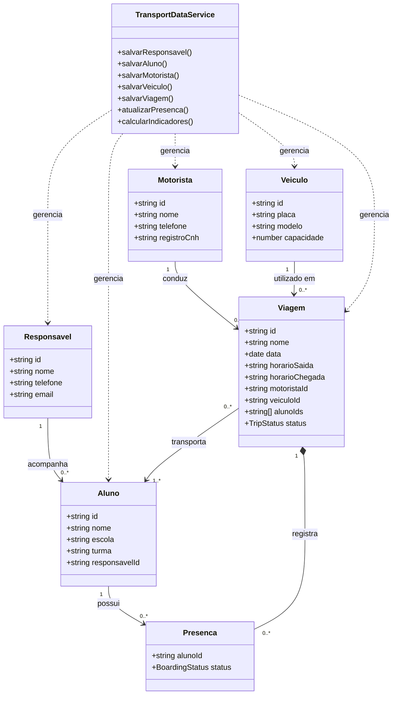

# Diagrama de classes — ToAqui

O modelo abaixo representa as entidades usadas pela Central operacional. As coleções são armazenadas no navegador para fins de demonstração.

## Regras de relacionamento

- Cada aluno deve estar associado a um responsável cadastrado.
- Cada viagem deve ter um motorista, um veículo e pelo menos um aluno.
- A quantidade de alunos da viagem não pode superar a capacidade do veículo.
- Uma viagem guarda um status de presença para cada aluno associado.
- Um motorista ou veículo não pode ser alocado a mais de uma viagem em andamento na mesma data.
- O CRUD impede excluir responsáveis, alunos, motoristas e veículos que ainda tenham vínculos ativos no modelo.

Os tipos `TripStatus` e `BoardingStatus`, os campos técnicos e as regras estão definidos em `src/app/operacao/transport-data.ts`.
